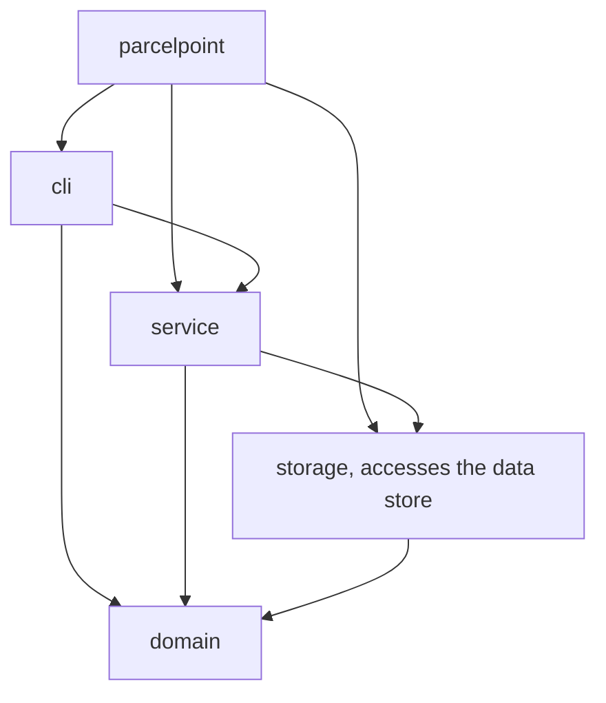
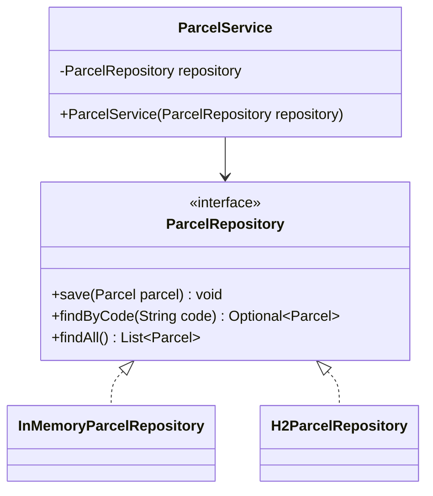
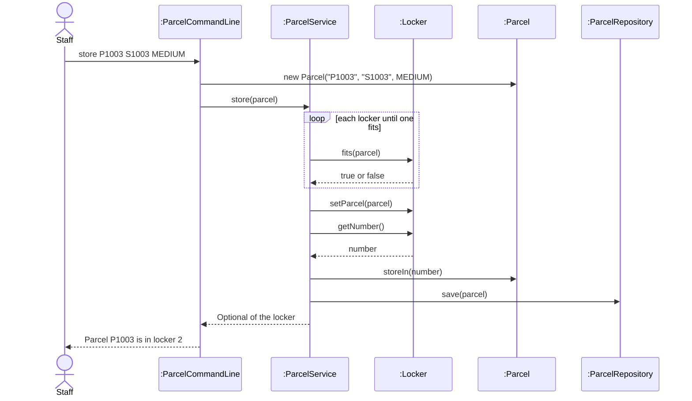

# Lab Report, Designing the Data Management Layer with H2

Repository URL: https://github.com/witthayut/itcs382-h2-lab

## Tools

| Item | Version or name |
| --- | --- |
| JDK | OpenJDK 25.0.4.1 LTS (Eclipse Temurin) |
| Maven | Apache Maven 3.10.0 |
| IDE | Visual Studio Code 1.146.0 with Extension Pack for Java |
| AI tool and exact model, if you used one | Claude Code, Claude Fable 5.2 |

## Part 0. From a store in memory to H2

Commit of the starter, before any change:4542ccc 

0.3 Your prediction for `staff`, written before the second run:

The terminal will show the same result as before: both parcels, P1001 in locker 1 and P1002 in locker 3, and Free lockers: 1.

Output of the second run, for `staff` and `quit`:

```text
> staff
Free lockers: 3
> quit
```

State in one sentence where you think the parcels of the first run were kept.
Ans: The parcels of the first run were kept only in the memory of the running program, in the map inside InMemoryParcelRepository, so they were lost when the program ended.


0.5 The line of Main that you would change to keep the parcels somewhere else:

```java
ParcelRepository repository = new InMemoryParcelRepository();
```

0.6 Commit of the switch to H2: 1f6078a 

0.7 Output of `SELECT * FROM PARCEL;` after you stored two parcels:

```text
sql> SELECT * FROM PARCEL;
CODE  | STUDENT_ID | PARCEL_SIZE | STATUS | LOCKER_NUMBER
P1001 | S1001      | SMALL       | STORED | 1
P1002 | S1002      | LARGE       | STORED | 3
(2 rows, 27 ms)
```

0.8 Explain why ParcelPoint could not start while the H2 Shell was open, and identify the class that wrote the message `Cannot create the PARCEL table`.
Ans: The H2 Shell was still open, and H2 only allows one program to use the database file at a time. It locked parcelpoint.mv.db for the Shell, so ParcelPoint failed when it tried to open the same file. The message "Cannot create the PARCEL table" was written by the H2ParcelRepository class, in its constructor.


0.9 Explain why `staff` shows no parcel while `find` shows each one, and why all three lockers look free.
Ans: find uses findByCode, which runs a real SQL SELECT on the database, so it shows each parcel. staff uses findAll, which was not written yet in the starter and only returned an empty list, so there was nothing to show. The constructor of ParcelService also calls findAll to put the waiting parcels back into the lockers at start, and with an empty list no locker got a parcel, so all three looked free.

0.11 Your findAll method:

```java
    @Override
    public List<Parcel> findAll() {
        String sql = "SELECT * FROM PARCEL ORDER BY CODE";
        List<Parcel> parcels = new ArrayList<>();
        try (Connection connection = connect();
             PreparedStatement statement = connection.prepareStatement(sql);
             ResultSet row = statement.executeQuery()) {
            while (row.next()) {
                parcels.add(toParcel(row));
            }
        } catch (SQLException e) {
            throw new IllegalStateException("Cannot read the parcels", e);
        }
        return parcels;
    }
```

Commit that adds findAll: 38cf198

0.12 Output of `SELECT * FROM PARCEL;` after the pickup:

```text
sql> SELECT * FROM PARCEL;
CODE  | STUDENT_ID | PARCEL_SIZE | STATUS    | LOCKER_NUMBER
P1001 | S1001      | SMALL       | PICKED_UP | null
P1002 | S1002      | LARGE       | STORED    | 3
(2 rows, 17 ms)
```

0.13 Optional. Describe what `find P9999'OR'1'='1` showed while the SQL was joined from strings, and what it showed after you put the placeholder back.

## Part A. Model the design

A1 Complete the flowchart with one node for each package and one arrow for each dependency, from the package that uses to the package that is used. Mark the package that accesses the data store.



State whether cli depends on storage, and explain why.
Ans: No, cli does not depend on storage. ParcelCommandLine imports only classes from domain and service, and it reaches the parcels through ParcelService, never through a repository directly. So a change of the data store does not affect cli.


A2 Complete the class diagram of the data management layer with ParcelService, the interface ParcelRepository with its three operations, and the two classes that implement it.




A3 Draw a sequence diagram for the command `store P1003 S1003 MEDIUM`, from the staff member to the repository. Show each message as an operation of the class that receives it.




Explain why the last lifeline is the interface ParcelRepository rather than H2ParcelRepository.
Ans: ParcelService only knows the interface ParcelRepository and calls save on it. It never names H2ParcelRepository, because Main chooses the real class. So the diagram ends at the interface.


## Part B. Design questions

1. Identify the files that you changed to move from the store in memory to H2, and explain why no other class had to change. Use the terms of this course.

Ans: I changed only Main.java. The other classes depend on the interface ParcelRepository, not on a real class (Dependency Inversion Principle), so they did not need to change.


2. The PARCEL table stores the size of a parcel as SMALL, MEDIUM or LARGE rather than as 1, 2 or 3. Identify the type of connascence between ParcelSize and the table in each case, and explain which one is weaker.

Ans: Storing SMALL, MEDIUM or LARGE is connascence of name. Storing 1, 2 or 3 is connascence of convention. Name is weaker, because the word already tells what it means.

3. Project Phase 2 asks for a data store that needs no separate server. Explain why an embedded database such as H2 meets this rule, and describe the limit of an embedded database that Step 0.8 showed.

Ans: H2 runs inside the program and saves data in a file, so it needs no server. The limit is that only one program can open the database at a time, as Step 0.8 showed.


4. State the data store that you would choose for your Project Phase 2 team, files or an embedded database, the requirement that drives the choice, and the package that will access it.
Ans: I would choose files in the folder ./data, because the data must stay after the program ends and needs no server. The package ocs.persistence would access them.

## AI usage declaration

| AI tool and exact model | Date | Purpose | Files or answers it produced or changed | How you checked its output |
| --- | --- | --- | --- | --- |
| Claude Code, Claude Fable 5.2 | 14 November 2026 | Step-by-step guide through the lab | Explained the commands and the code of Steps 0.1 to 0.12 | I ran every step myself and compared the output with the lab sheet. |
| Claude Code, Claude Fable 5.2 | 14 November 2026 | Check errors in my code | Corrected the SQL and the error message of my findAll in H2ParcelRepository.java | I built the project with mvn package, ran staff, and saw both parcels and Free lockers: 1. |
| Claude Code, Claude Fable 5.2 | 14 November 2026 | Guiding the answers and the diagrams | Helped me write and check the answers of Part 0, Part A and Part B, and the Mermaid diagrams of Part A| I compared the answers and the diagrams with the Java code and with what I saw when I ran the steps. |

